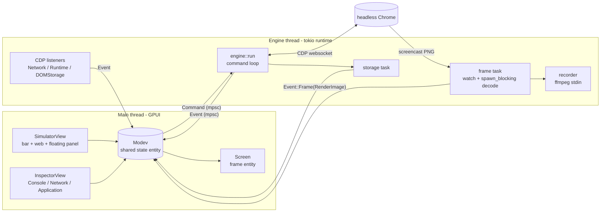

# Architecture

modev is a single Rust binary with two halves: a GPUI user interface on the main thread, and an
**engine** that drives headless Chrome over the Chrome DevTools Protocol (CDP) on its own tokio runtime. The two
halves only talk through channels.

## Data flow

1. `main.rs` creates the `Modev` entity and opens the simulator window. `Modev::new` creates two unbounded tokio
   mpsc channels and calls `engine::spawn`, which starts a `std::thread` running a multi-threaded tokio runtime.
2. The UI sends `engine::Command`s (touch, wheel, keys, navigate, set device, throttle, evaluate, screenshot,
   record, storage requests…). The engine loop merges bursts of `Resize`, `Wheel` and `TouchMove` so input does
   not queue up behind Chrome's acknowledgements.
3. The engine sends `engine::Event`s back. A `cx.spawn` task in `Modev` receives them and calls `Modev::handle`
   on the main thread.
4. Screencast frames (`Page.screencastFrame`, PNG) go through a `tokio::sync::watch` channel so only the newest
   frame is decoded (`spawn_blocking`, PNG → BGRA `RenderImage`). The UI stores it in the `Screen` entity, which
   is separate so the inspector does not re-render at 30–60 fps. The recorder reads the same `watch` and pipes
   frames to `ffmpeg` at 30 fps.
5. Storage requests (`Command::Storage`) run in their own task with raw CDP calls and answer with
   `Event::Storage` / `Event::StorageError`.

## Module map

| Module | Responsibility |
| --- | --- |
| `main.rs` | App setup, theme, opens the simulator window |
| `engine.rs` | Chrome launch, CDP command loop, device emulation, screencast, input, network/console listeners, screenshot, MP4 recording, PDF rasterization helper |
| `device.rs` | `DeviceProfile`, Firefox-derived presets, user/hidden device files, `config_file` |
| `settings.rs` | `settings.json` load/save, capture paths |
| `adb.rs` | adb server protocol: keeps the server running, tracks devices, lists DevTools targets (Chrome tabs, WebViews) through `adb forward` |
| `updater.rs` | Update check against the `latest.json` of the latest GitHub release |
| `storage.rs` | Application tab backend: Local/Session storage, IndexedDB, cookies, Cache storage (raw CDP) |
| `theme.rs` | Dark palette, light-mode token mapping (`theme::rgb`), gpui-kit theme install |
| `icons.rs` | Embedded Hugeicons SVGs and the `Assets` source |
| `ui.rs` | `Modev` state + event handling, `SimulatorView`, `Screen`, device panel, window controls |
| `ui/android.rs` | Android tab: devices and pages, Inspect / Back (remote session state) |
| `ui/tools.rs` | Tools and Settings panels (color scheme, screenshot, timer, recording, theme, capture folder) |
| `ui/inspector.rs` | `InspectorView`: Console and Network tabs, request detail, Replay editor |
| `ui/inspector/application.rs` | Application tab UI |
| `ui/net_tools.rs` | UI-free Network logic: JWT decoding, HAR export, search ranges |
| `ui/selectable.rs` | Selectable/highlightable text for the inspector |

## Threading model

- **Main thread**: GPUI. All UI state lives in the `Modev` entity; views hold only window-bound state (inputs).
- **Engine thread**: one OS thread owning a multi-threaded tokio runtime. It hosts the chromiumoxide handler, the
  command loop, CDP event listeners, frame decoding (`spawn_blocking`), the storage task and the recorder.
- Background UI work (PDF rasterization with `hayro`) uses `cx.background_spawn`.

## Persistence

Everything is plain JSON under `$XDG_CONFIG_HOME/modev/` or `~/.config/modev/`: `settings.json`, `devices.json`,
`hidden-devices.json`. Captures go to the configured folder.

## Design decisions

These are intentional; please discuss in an issue before changing them.

- UI with GPUI + gpui-kit. No phone frame: the web is a box with a border.
- Window controls follow the desktop (on Linux, `button-layout` filtered by what the compositor supports).
  No maximize button, no macOS traffic lights.
- The simulator is one window (one dock icon): bar, web and floating panel are fixed to each other.
- All windows are transparent and opened without gpui-kit's `Root` (it paints an opaque background and square
  corners). Content sits in a rounded panel with a border. In the inspector the content is inset 3 px so
  rectangular backgrounds don't stick out of the corners.
- The inspector is native GPUI imitating Chrome DevTools, not the embedded DevTools frontend.
- Closing the simulator quits the app, including Chrome.
- Colors always go through `theme::rgb` with a token that has a light-mode pair.

## Gotchas

- chromiumoxide prepends `--` to `.arg()`: pass args without the prefix; with a value use a tuple.
- The headless screencast captures at the virtual screen's scale, not the emulated DPR: modev passes
  `force-device-scale-factor` and a large `screen-info` / `ozone-override-screen-size` (headless defaults to
  800×600 and crops the viewport).
- chromiumoxide's `DispatchTouchEventParams` omits an empty `touchPoints`, so Chrome rejects `touchEnd`
  (-32602). modev uses a custom `DispatchTouch` command. On another -32602, check `skip_serializing_if` in params.
- `Page.frameNavigated` arrives after the document request: Network/Console are cleared when the navigation
  request starts (`is_navigation`).
- Redirects reuse `requestId`: the previous entry is closed with its `redirectResponse`.
- Response bodies are not fetched for everything (dev servers serve multi-MB scripts): only Fetch/XHR/Document/Other
  when they finish; the rest on selection.
- Sharpness: the screencast is requested at exactly `zoom × window scale`, the zoom snaps to a whole width, and the
  frame is painted 1:1. GPUI's bilinear scaling (no mipmaps) blurs text otherwise.
- GPUI expects BGRA, and old frames must be released with `window.drop_image` or the atlas grows unbounded.
- The favicon is loaded with `Network.loadNetworkResource` + `IO.read`; a `fetch` from the page would show up in
  Network.
- Replay uses `fetch()` from the page: same origin and cookies, but forbidden headers (Cookie, Host, Origin…) are
  dropped and HTTP/2 pseudo-headers are filtered out.
- `IndexedDB.requestData` fails with `indexName: ""`: omit it when there is no index. Values come back as
  `RemoteObject`; full JSON is obtained with `Runtime.callFunctionOn` + `JSON.stringify` (then `releaseObject`).
- Without `Root`, the inspector paints its own text-selection layer and handles Ctrl+C via the `CopySelection`
  action (key context `Inspector`).
- Wayland: windows cannot be positioned by the app; undecorated windows need a drag zone (`start_window_move`) and
  resize borders (`start_window_resize`).

## Known risks for contributors

- `ui.rs` and `ui/inspector.rs` are ~2,000 lines each; `engine.rs` and `ui/inspector/application.rs` ~1,000+.
  Changes there need care and touch a lot of shared state in `Modev`.
- Unit tests cover only UI-free logic (`cargo test`); the engine and the UI are tested by hand.
- Platform-specific code is small (window controls in `ui.rs`, icon embedding in `build.rs`), but macOS and Windows
  are only verified by `cargo check` in CI.
- Behavior depends on Chrome's CDP, which changes between versions; see the gotchas above.
