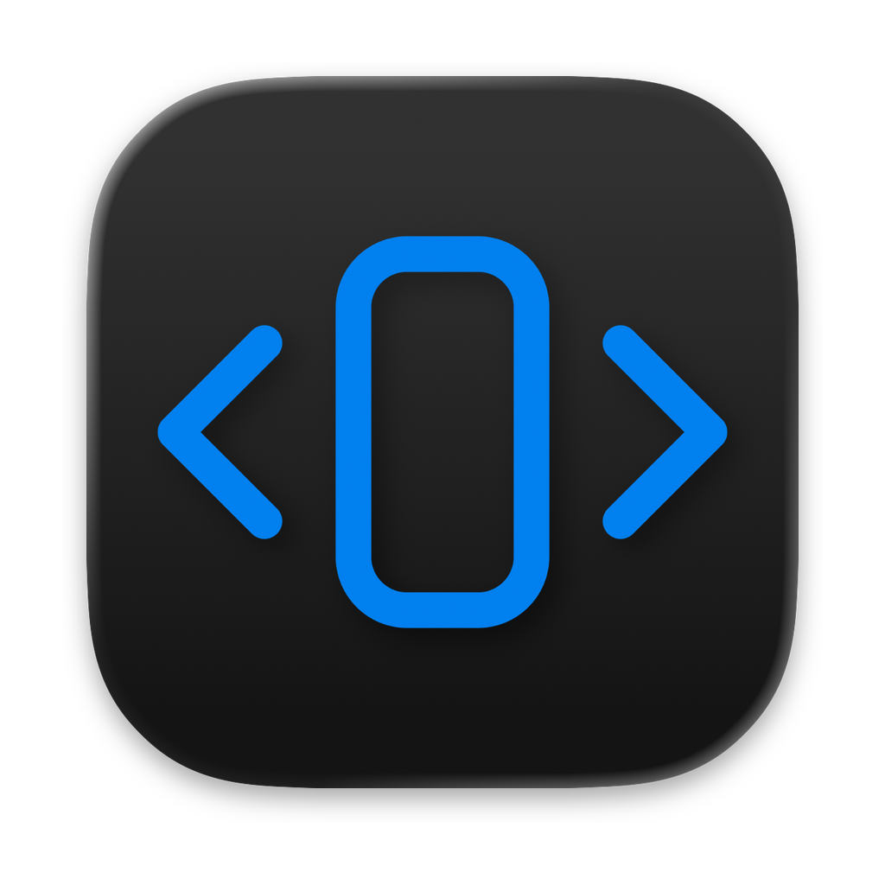
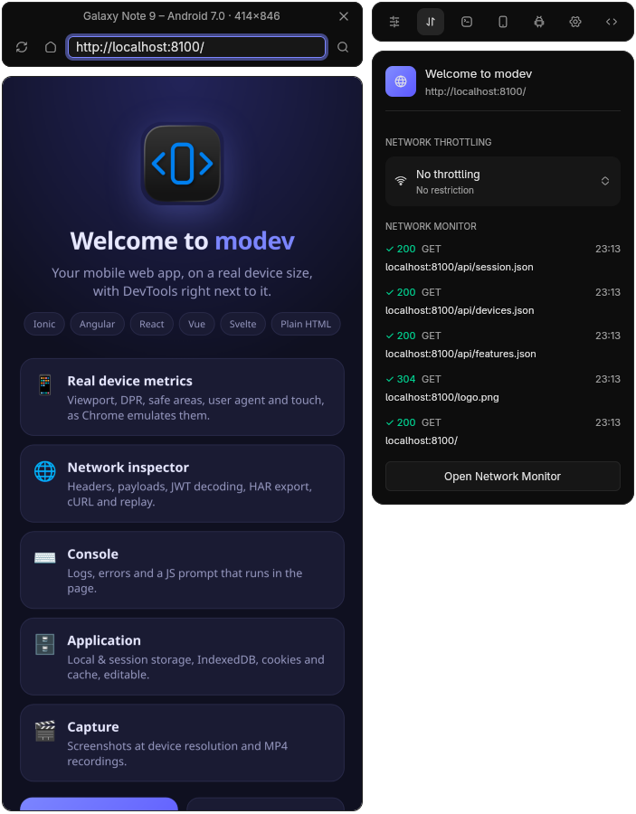
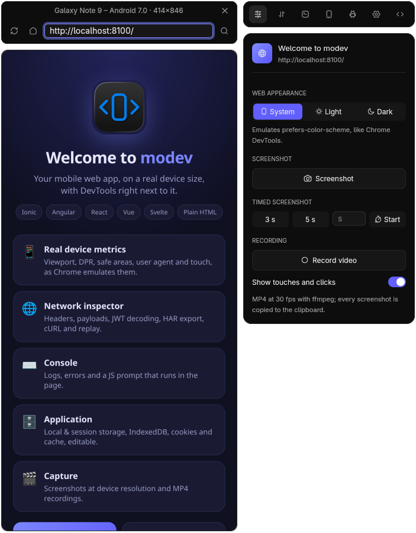
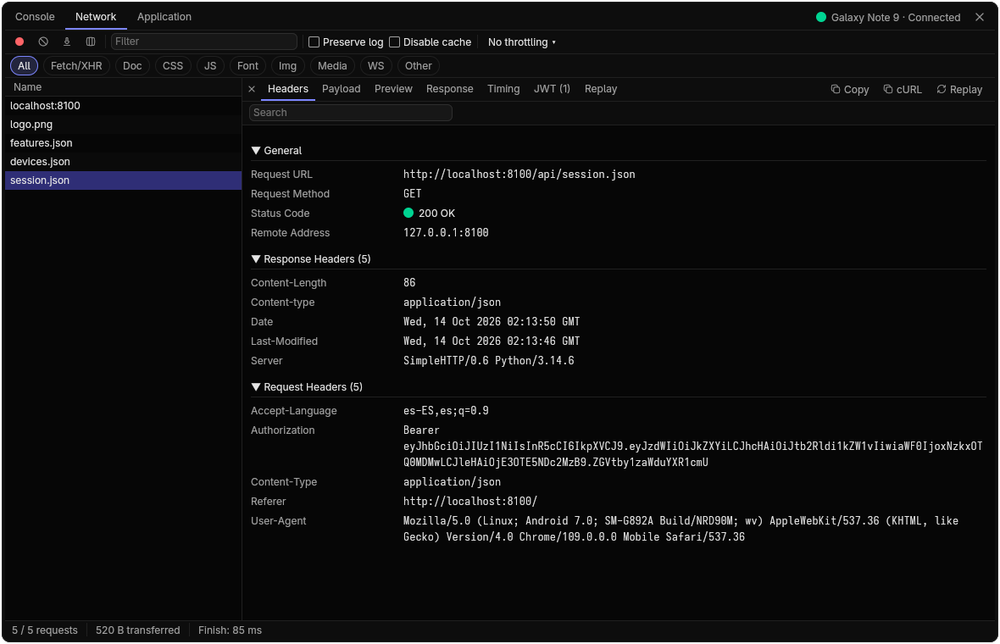

<p align="center">
  
</p>

<h1 align="center">modev</h1>

<p align="center">A native device simulator for developing mobile web apps: Ionic, Angular, React, Vue, Svelte, React Native
for Web, PWAs or plain HTML.</p>

modev renders your dev server inside an emulated phone or tablet, as faithfully as Chrome allows:
CSS viewport, device pixel ratio, safe areas, user agent and touch input. Next to it you get a native inspector modeled on
Chrome DevTools (Console, Network, Application), plus screenshots and screen recordings. It is written in Rust with
[GPUI](https://www.gpui.rs/) ([gpui-kit](https://crates.io/crates/gpui-kit)) and drives headless Chrome over the
DevTools Protocol.

It is for developers who build hybrid/mobile web apps and want a fast, always-on-top-of-the-dev-server device preview
without launching an emulator.

<p align="center">
  
  
</p>

## Features

- **Device emulation**: viewport, DPR, safe-area insets (`env(safe-area-inset-*)`), user agent, `navigator.platform`
  and touch events. Phone and tablet presets come from Firefox's device list, and you can add your own devices or
  hide presets.
- **Responsive mode**: free-size device with numeric fields and drag handles, resized without reloading.
- **Simulator window**: URL bar, reload, home, page title and favicon. Mouse input is translated to touch, and the
  wheel scrolls.
- **Console**: logs, exceptions, filtering, preserve log and JS evaluation in the page.
- **Network**: request table with type filters and configurable columns. Request details: headers, payload,
  preview (JSON, images, PDF), response, timing. Search, JWT decoding, *Copy as cURL*, HAR export, *Replay* of an
  editable request from the page, throttling (Fast 4G / Slow 4G / Slow 3G / Offline), disable cache.
- **Application**: Local/Session storage, IndexedDB, cookies and Cache storage, with editing.
- **Tools**: toggle the page's `prefers-color-scheme`, PNG screenshot at device resolution (saved to a file and copied
  to the clipboard), countdown timer, MP4 recording with `ffmpeg` (optionally drawing touches).
- **Settings**: light/dark/auto theme, capture folder, remember last device, update check against GitHub releases
  (on launch and on demand).

<p align="center">
  
</p>

## Install

Download the package for your platform from the [latest release](https://github.com/yosoyjaff/modev/releases/latest).
Google Chrome or Chromium must be installed; `ffmpeg` is optional (recordings).

| Platform | Package |
| --- | --- |
| macOS (Apple silicon / Intel) | `modev-macos-aarch64.dmg` / `modev-macos-x86_64.dmg` |
| Windows | `modev-windows-<arch>.msi` (installer) or `.zip` (portable) |
| Debian/Ubuntu | `sudo apt install ./modev-linux-<arch>.deb` |
| Fedora/openSUSE | `sudo dnf install ./modev-linux-<arch>.rpm` |
| Other Linux | `modev-linux-<arch>.tar.gz` (binary, `.desktop` entry and icons) |

Checksums are in `SHA256SUMS` on each release.

### Unsigned builds

The packages are not code-signed yet, so the first launch shows a security warning:

- **macOS**: "modev can't be opened because Apple cannot check it for malicious software". Right-click the app in
  Applications → **Open** → **Open**, or allow it in **System Settings → Privacy & Security → Open Anyway**. Only
  needed once. Alternatively: `xattr -dr com.apple.quarantine /Applications/Modev.app`.
- **Windows**: SmartScreen shows "Windows protected your PC". Click **More info** → **Run anyway**. Only needed once
  per downloaded file.
- **Linux**: no warning. Verify the download with `sha256sum -c SHA256SUMS --ignore-missing`.

## Build from source

- Rust (edition 2024; see `rust-version` in `Cargo.toml`).
- Google Chrome or Chromium installed (found by [chromiumoxide](https://crates.io/crates/chromiumoxide)).
- Optional: `ffmpeg` on `PATH` for recordings.
- Linux: the system libraries GPUI needs to build:

  ```sh
  # Debian/Ubuntu
  sudo apt install pkg-config libxkbcommon-dev libxkbcommon-x11-dev libwayland-dev \
    libvulkan-dev libx11-xcb-dev libfontconfig-dev libfreetype-dev
  # Fedora
  sudo dnf install pkgconf-pkg-config libxkbcommon-devel libxkbcommon-x11-devel wayland-devel \
    vulkan-loader-devel libxcb-devel fontconfig-devel freetype-devel
  ```

## Usage

```sh
cargo run --release -- http://localhost:8100
```

The first argument is the URL to open (default `http://localhost:8100`); any dev server works (Vite, Next.js, Angular CLI, Expo web…). The inspector opens on
demand from the simulator. Closing the simulator quits the app and Chrome.

## Configuration

Stored under `$XDG_CONFIG_HOME/modev/` (default `~/.config/modev/`):

| File | Contents |
| --- | --- |
| `settings.json` | Theme, capture folder, remember device, last device, recording options |
| `devices.json` | User-defined devices |
| `hidden-devices.json` | Presets removed by the user ("Restore" brings them back) |

Screenshots and recordings go to your Downloads folder by default (configurable in Settings).

## Packaging

- App icons live in `assets/app-icon/` (macOS `.icns`, Windows `.ico`, Linux hicolor + `.desktop`); the source image
  is `assets/logo/logo-iOS-Dark-1024x1024@1x.png`.
- Windows: `build.rs` embeds the `.ico` into the executable (`winresource`); `cargo wix` builds the MSI from
  `wix/main.wxs`.
- macOS: `cargo bundle --release` ([cargo-bundle](https://github.com/burtonageo/cargo-bundle)) builds `Modev.app`.
- Linux: `cargo deb` / `cargo generate-rpm` build the packages (metadata in `Cargo.toml`); `assets/app-icon/linux/`
  has the hicolor icons and `modev.desktop`.

Releases are built by `.github/workflows/release.yml` when a `v*` tag is pushed: macOS `.dmg`, Windows `.msi` installer and
portable `.zip`, Linux `.deb`, `.rpm` and `.tar.gz` (x86_64 and aarch64), with `SHA256SUMS` and the `latest.json` manifest the update check reads.

## Platforms

Developed and tested on Linux. macOS and Windows are checked in CI but not yet tested by hand.

## Known limitations

- Rendering is Chrome (Blink) for every device: iOS presets emulate Safari's metrics and UA, not WebKit itself.
- Preset ppi and safe-area values are approximations.
- The emulated `Accept-Language` is fixed to `es-ES`.
- The inspector has no Elements or Sources tab yet.
- The update check only links to the new package; it does not install it.
- On Wayland the app cannot position its windows.

See [ROADMAP.md](ROADMAP.md).

## Contributing

See [CONTRIBUTING.md](CONTRIBUTING.md) and [ARCHITECTURE.md](ARCHITECTURE.md). Security issues: [SECURITY.md](SECURITY.md).

## License

[MIT](LICENSE).

Third-party assets: icons from [Hugeicons](https://hugeicons.com/) (MIT, see `assets/icons/LICENSE-hugeicons.md`).
`src/ui/selectable.rs` is adapted from `gpui_base::SelectableText` (MIT/Apache-2.0).
